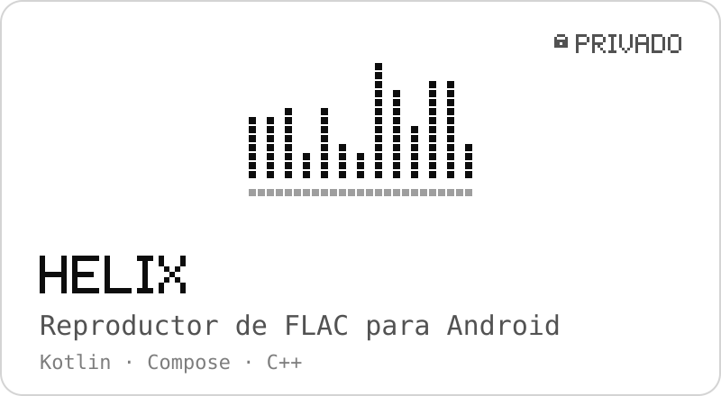

  <picture>
    <source media="(prefers-color-scheme: dark)" srcset="assets/banner-oscuro.svg">
    
  </picture>

  <b>Erick Torres</b> · Estudiante de Ingeniería en Sistemas Computacionales

  Hago las herramientas que yo mismo uso: un overlay para directos, apps para Android y Linux, 
  plugins y mods de Minecraft y algún aparato con un ESP32.

  <picture>
    <source media="(prefers-color-scheme: dark)" srcset="assets/separador-oscuro.svg">
    
  </picture>

### Ahora mismo

- Acabo de publicar **[HelCam](https://github.com/Helminth117/helcam)**: pones dos dedos en la frente y te teletransportas de la videollamada, estilo anime.
- Pasando el panel de **HelminthsOverlay** a Flutter, para controlarlo igual desde Windows que desde Android.
- Afinando **Helix**, mi reproductor de FLAC para Android, para que suene bit-perfect por un DAC USB.

  <picture>
    <source media="(prefers-color-scheme: dark)" srcset="assets/separador-oscuro.svg">
    
  </picture>

### Proyectos destacados

  <a href="https://github.com/Helminth117/helcam"><picture>
    <source media="(prefers-color-scheme: dark)" srcset="assets/proyectos/helcam-oscuro.svg">
    
  </picture></a>
  <a href="#contacto"><picture>
    <source media="(prefers-color-scheme: dark)" srcset="assets/proyectos/overlay-oscuro.svg">
    
  </picture></a>

  <a href="#contacto"><picture>
    <source media="(prefers-color-scheme: dark)" srcset="assets/proyectos/helix-oscuro.svg">
    
  </picture></a>
  <a href="#contacto"><picture>
    <source media="(prefers-color-scheme: dark)" srcset="assets/proyectos/encender-pc-oscuro.svg">
    
  </picture></a>

  <a href="#contacto"><picture>
    <source media="(prefers-color-scheme: dark)" srcset="assets/proyectos/herederos-oscuro.svg">
    
  </picture></a>
  <a href="#contacto"><picture>
    <source media="(prefers-color-scheme: dark)" srcset="assets/proyectos/hardcore-oscuro.svg">
    
  </picture></a>

  <a href="https://github.com/Helminth117/doc2md_app"><picture>
    <source media="(prefers-color-scheme: dark)" srcset="assets/proyectos/doc2md-oscuro.svg">
    
  </picture></a>
  <a href="https://github.com/Helminth117/subneteo-paso-a-paso"><picture>
    <source media="(prefers-color-scheme: dark)" srcset="assets/proyectos/subneteo-oscuro.svg">
    
  </picture></a>

Los privados no tienen el código abierto; si te interesa alguno, <a href="#contacto">escríbeme</a>.

<b>Más proyectos</b>

 

| Proyecto | Qué es |
|---|---|
| [**Algoritmos-Busqueda-AI**](https://github.com/Helminth117/Algoritmos-Busqueda-AI) | BFS y DFS aplicados a Torres de Hanoi, Jarras de Agua y 8-Puzzle, con interfaz en Swing. |
| [**Procesador-Imagenes-Java**](https://github.com/Helminth117/Procesador-Imagenes-Java) | Filtros de imagen e histogramas RGB con interfaz en Swing. |
| [**Hyprland-Minecraft-Tools**](https://github.com/Helminth117/Hyprland-Minecraft-Tools) | Herramienta AFK para Minecraft en Wayland con `hyprctl` e `ydotool`. |
| [**Sensor-de-agua-arduino**](https://github.com/Helminth117/Sensor-de-agua-arduino) | Nivel de agua con un ESP32 y una gráfica en tiempo real servida desde la propia placa. |
| [**Python-Store-Logic**](https://github.com/Helminth117/Python-Store-Logic) | Inventario, ventas y estadísticas de una tienda de un juego de rol. |
| **TikTok LIVE Studio MCP** 🔒 | Servidor MCP para manejar escenas, fuentes y capturas de TikTok LIVE Studio desde Claude Code. |
| **Helminth's Graves** · **Temperature** 🔒 | Plugins para el servidor Handicraft: tumbas para Java y Bedrock, y temperatura corporal. |

  <picture>
    <source media="(prefers-color-scheme: dark)" srcset="assets/separador-oscuro.svg">
    
  </picture>

### Stack

<b>LENGUAJES</b>

  
  
  
  
  
  
  

<b>FRAMEWORKS Y PLATAFORMAS</b>

  
  
  
  
  
  
  
  

<b>HARDWARE</b>

  
  

<b>SISTEMAS Y HERRAMIENTAS</b>

  
  
  

  <picture>
    <source media="(prefers-color-scheme: dark)" srcset="assets/separador-oscuro.svg">
    
  </picture>

### Actividad

  <picture>
    <source media="(prefers-color-scheme: dark)" srcset="https://raw.githubusercontent.com/Helminth117/Helminth117/stats/stats-oscuro.svg">
    
  </picture>

  <picture>
    <source media="(prefers-color-scheme: dark)" srcset="https://raw.githubusercontent.com/Helminth117/Helminth117/output/serpiente-oscuro.svg">
    
  </picture>

### Setup

- **Cortana**, el PC: Ryzen 5 8600G · RTX 3070 · 64 GB DDR5 · Windows 11
- **Gwynevere**, el portátil: Ryzen 5 PRO 5650U · Omarchy (Arch Linux + Hyprland). I use Arch btw.

### Contacto

  
  

  <picture>
    <source media="(prefers-color-scheme: dark)" srcset="assets/monstruo-oscuro.svg">
    
  </picture>

  Si no estoy programando, probablemente estoy de cacería en Monster Hunter.

